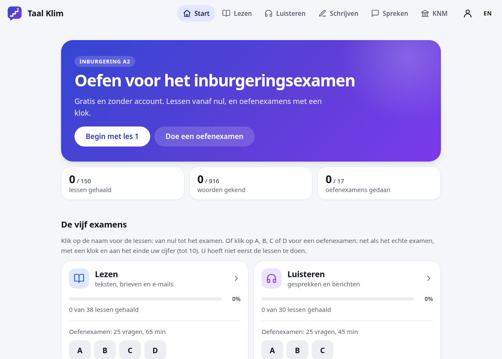
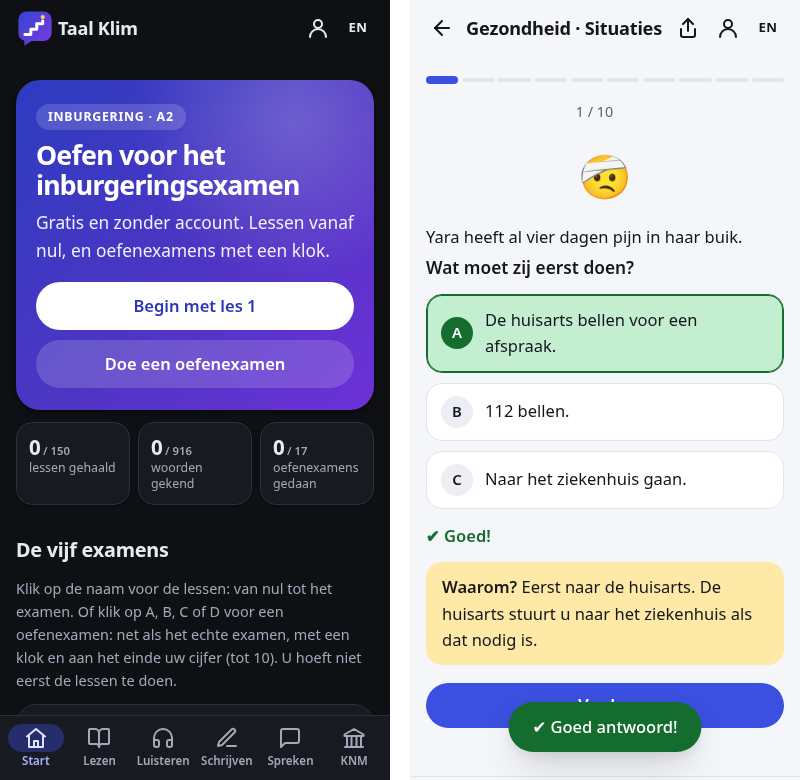

<p align="center">
  <picture>
    <source media="(prefers-color-scheme: dark)" srcset="docs/logo-donker.svg">
    
  </picture>
</p>

# Taal Klim: Dutch A2 inburgering exam prep

Free practice site for the Dutch A2 civic integration exam (inburgeringsexamen), from almost zero to exam level.
It covers all five exams: **Lezen, Luisteren, Schrijven, Spreken and KNM**.






## What is in it

- 150 short lessons: Lezen 38, Luisteren 30, Schrijven 24, Spreken 26, KNM 32.
- A ladder of 5 steps (trede 0-4). A lesson only uses words from its own step or lower; new words are marked and clickable.
- Word review with spaced repetition. Progress is saved in your browser, there is no account.
- After a practice exam, save the questions you got wrong or marked (or one by one) in My questions (`mijn-vragen.html`): one list for all exams, to practise them again, together or per exam.
- Click any word for its card: listen, translation, save to your own list (My words). A compound word also shows its parts: ziekenhuis = zieken + huis.
- Dutch audio for every word, sentence and listening text (already included as mp3).
- Level and vocabulary are calibrated on the official DUO practice exams.
- The practice exams work like DUO's own practice exams: the same number of questions, time, parts and answer options; a clock that warns at 15 and 1 minute; questions you can mark; Luisteren plays the intro, fragment, question and answers by itself, with 10 seconds back and forward; KNM reads every question and answer aloud; Spreken records at most 1 minute per question; Schrijven is on paper that looks like DUO's.
- Your mark follows DUO's pass line, not 60%: a 6,0 is 17 of 25 for Lezen, 19 of 25 for Luisteren and 28 of 40 for KNM (what DUO's own practice exams show), and the "voldoende" level of DUO's scoring model for Schrijven and Spreken. After a practice exam you see DUO's chance of passing and where your points went.
- Works on phone, tablet and desktop, with a light and a dark theme (☀ / 🌙 in the header, or automatic).
- After a right answer the next question comes by itself; you can click back to earlier steps and questions of a lesson.
- Start again per exam or completely on the settings page (⚙).
- A profile card to share with friends: your name, lessons passed and best practice-exam marks (`profiel.html`). Optional login with Google keeps progress on every device; it is off until the site has a config file, see [docs/inloggen.md](docs/inloggen.md).
- Share a lesson or a practice exam with the share button in the header. The link opens that lesson directly, also for someone who did not do the lessons before it.
- Help in English or Persian (فارسی): with the buttons, in the explanations and behind the translation button with a word. Choose the language on the settings page; the lessons themselves stay Dutch.

The study plan and the plan per exam are in [`plans/`](plans/0-masterplan.md).

Not included: the three official DUO writing practice exams (the "DUO 1-3" links on the Schrijven page). They belong to the Dutch government. Download them from [inburgeren.nl](https://www.inburgeren.nl/en/taking-the-integration-exam/practicing.jsp) and save them as `schrijven/toets/schrijven1.pdf`, `schrijven2.pdf` and `schrijven3.pdf`.

## Run it

You need Python 3 and a browser. Nothing to install or build.

```bash
git clone git@github.com:coditori/dutch-a2-inburgering-exam-prep.git
cd dutch-a2-inburgering-exam-prep
python3 -m http.server 8000
```

Open http://localhost:8000. Opening `index.html` as a file does not work, because the pages load their lessons with `fetch`.

Any static file server works too.

## Online version (GitHub Pages)

The site also runs online, without installing anything: https://ariogrey.com/dutch-a2-inburgering-exam-prep/

Lessons, tests, trainers, audio and word review all work there. What is different from running it on your own computer:

| Feature | Online |
|---------|--------|
| Speaking check (speech to text) | Uses the browser's own speech recognition, which exists in Chrome and Edge and sends your audio to Google. In other browsers you record, listen and check yourself. The local speech server below is meant for the site on your own computer. |
| Official DUO writing exams | Not included. The "DUO 1-3" tiles open the practice page on inburgeren.nl instead. |
| Your progress | Saved in the browser, per address. Progress made on `localhost` does not show up online, and the other way round. Move it with "Bewaar in een bestand" and "Lees uit een bestand" on the settings page (⚙). |
| Recording your voice | Needs microphone permission for the site. |

## Optional: speech tools

Only needed if you want your speaking checked on your own computer, or want to make audio for new lessons.

Requirements: [uv](https://docs.astral.sh/uv/), `ffmpeg`, and Python 3.12 (uv downloads it).

```bash
uv venv --python 3.12 tools/.venv
uv pip install --python tools/.venv/bin/python -r tools/requirements.txt
```

**Check your speaking** (speech to text with faster-whisper; the first start downloads a model of about 500 MB):

```bash
tools/.venv/bin/python tools/stt_server.py
```

Run it next to the web server. Without it, the speaking pages use Chrome's speech recognition, or you check yourself.

**Make audio for new lessons.** All voices come from Google Cloud Text-to-Speech. Put a key in `tools/google-sleutel.txt` (not in git).
The narrator (every word and sentence with a speaker button, and the questions and answers of the practice exams) has four voices,
listed in `shared/stemmen.json`:

```bash
tools/.venv/bin/python tools/tts_stemmen.py --ja   # all narrator voices, only what is missing (run one voice at a time with --stem)
python3 tools/controleer_stemmen.py                # does every voice have every text?
```

The roles in the Luisteren dialogues (two men, two women) and the questions in Spreken have their own fixed voices. Without `--ja`
the scripts only show what is missing; `--ja` makes it, which uses credit at Google:

```bash
python3 tools/tts_luisteren.py --ja   # the roles, and one recording per fragment of a practice exam
python3 tools/tts_spreken.py --ja     # the speaking questions
```

**Photos for the practice exams.** DUO uses real photos. Each question of the KNM, Spreken and Luisteren practice exams has a
description (`foto` / `fotos` in the JSON); `tools/plaatjes.py` turns them into photos with a Google image model. Put a key from
[Google AI Studio](https://aistudio.google.com/apikey) in `tools/gemini-sleutel.txt` (not in git; image generation needs billing):

```bash
python3 tools/plaatjes.py --proef 3   # three photos, to look at first
python3 tools/plaatjes.py --ja        # all missing photos
```

Without photos the pages show the emoji pictures.

## Add or change a lesson

Lessons are JSON files in `<exam>/lessons/` (KNM: `knm/themes/`). After a change:

```bash
python3 tools/bouw.py        # rebuild shared/woorden.js and the lesson lists
python3 tools/controleer.py  # check that the lesson only uses allowed words
python3 tools/controleer_fa.py -v  # list English help texts that have no Persian yet (add them to shared/fa.js)
```

Compound words (ziekenhuis = zieken + huis) are split by `tools/bouw.py` when both parts are in the word list. A split that is missing or wrong goes in `woorden/samenstellingen.txt`.

## Version

The version is one line in `shared/app.js` (`const VERSIE`) and is shown at the bottom of every page. You do not change it by hand: the workflow `.github/workflows/versie.yml` bumps it once per pull request and commits it to the PR branch. A branch named `feat/...` gives a minor bump, `major/...` a major bump, any other name a patch bump. By hand: `python3 tools/versie.py --verhoog patch`.

## Contributing

**Changes go to a feature branch, never directly to `main`.** Create a branch, push it and open a pull request.

## Licence

[CC BY-NC-SA 4.0](https://creativecommons.org/licenses/by-nc-sa/4.0/): free to use and adapt for non-commercial purposes, with credit, under the same licence. See [`LICENSE`](LICENSE).

This is an independent project. It is not made or approved by DUO.
