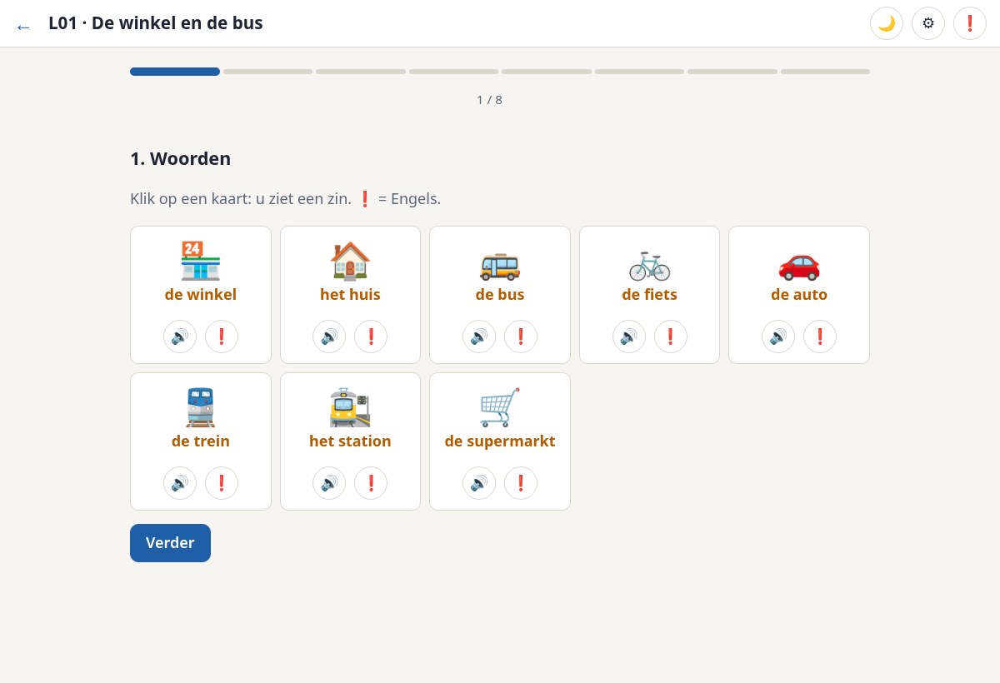

# Dutch A2 inburgering exam prep

Free practice site for the Dutch A2 civic integration exam (inburgeringsexamen), from almost zero to exam level.
It covers all five exams: **Lezen, Luisteren, Schrijven, Spreken and KNM**.




## What is in it

- 150 short lessons: Lezen 38, Luisteren 30, Schrijven 24, Spreken 26, KNM 32.
- A ladder of 5 steps (trede 0–4). A lesson only uses words from its own step or lower; new words are marked and clickable.
- Word review with spaced repetition. Progress is saved in your browser, there is no account.
- Dutch audio for every word, sentence and listening text (already included as mp3).
- Level and vocabulary are calibrated on the official DUO practice exams.
- Works on phone, tablet and desktop, with a light and a dark theme (☀ / 🌙 in the header, or automatic).
- After a right answer the next question comes by itself; you can click back to earlier steps and questions of a lesson.
- Start again per exam or completely on the settings page (⚙).

The study plan and the plan per exam are in [`plans/`](plans/0-masterplan.md).

Not included: the three official DUO writing practice exams (the "DUO 1–3" links on the Schrijven page). They belong to the Dutch government. Download them from [inburgeren.nl](https://www.inburgeren.nl/en/taking-the-integration-exam/practicing.jsp) and save them as `schrijven/toets/schrijven1.pdf`, `schrijven2.pdf` and `schrijven3.pdf`.

## Run it

You need Python 3 and a browser. Nothing to install or build.

```bash
git clone git@github.com:coditori/dutch-a2-inburgering-exam-prep.git
cd dutch-a2-inburgering-exam-prep
python3 -m http.server 8000
```

Open http://localhost:8000. Opening `index.html` as a file does not work, because the pages load their lessons with `fetch`.

Any static file server works too, so you can also host it on GitHub Pages.

## Optional: speech tools

Only needed if you want your speaking checked on your own computer, or want to make audio for new lessons.

Requirements: [uv](https://docs.astral.sh/uv/), `ffmpeg`, and Python 3.12 (uv downloads it).

```bash
uv venv --python 3.12 tools/.venv
uv pip install --python tools/.venv/bin/python -r tools/requirements.txt
```

**Check your speaking** (speech to text with faster-whisper; the first start downloads a model of about 500 MB):

```bash
tools/.venv/bin/python tools/stt_server.py
```

Run it next to the web server. Without it, the speaking pages use Chrome's speech recognition, or you check yourself.

**Make audio for new lessons** (text to speech with Piper; each voice is about 60 MB):

```bash
tools/.venv/bin/python -m piper.download_voices nl_NL-ronnie-medium nl_NL-pim-medium nl_BE-nathalie-medium --data-dir tools/voices
tools/.venv/bin/python tools/tts.py            # words and sentences
tools/.venv/bin/python tools/tts_luisteren.py  # also: tts_spreken.py, tts_knm.py
```

## Add or change a lesson

Lessons are JSON files in `<exam>/lessons/` (KNM: `knm/themes/`). After a change:

```bash
python3 tools/bouw.py        # rebuild shared/woorden.js and the lesson lists
python3 tools/controleer.py  # check that the lesson only uses allowed words
```

## Contributing

**Changes go to a feature branch, never directly to `main`.** Create a branch, push it and open a pull request.

## Licence

[CC BY-NC-SA 4.0](https://creativecommons.org/licenses/by-nc-sa/4.0/): free to use and adapt for non-commercial purposes, with credit, under the same licence. See [`LICENSE`](LICENSE).

This is an independent project. It is not made or approved by DUO.
